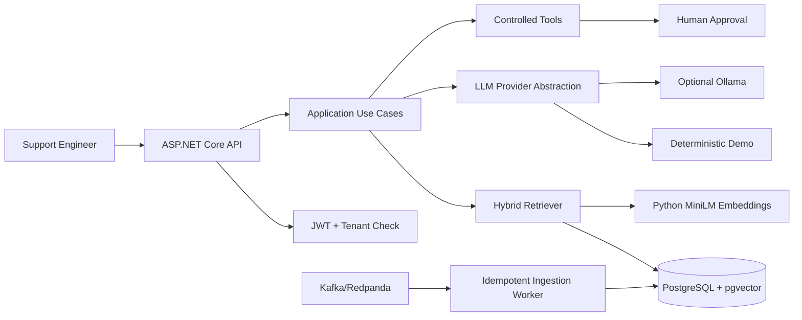
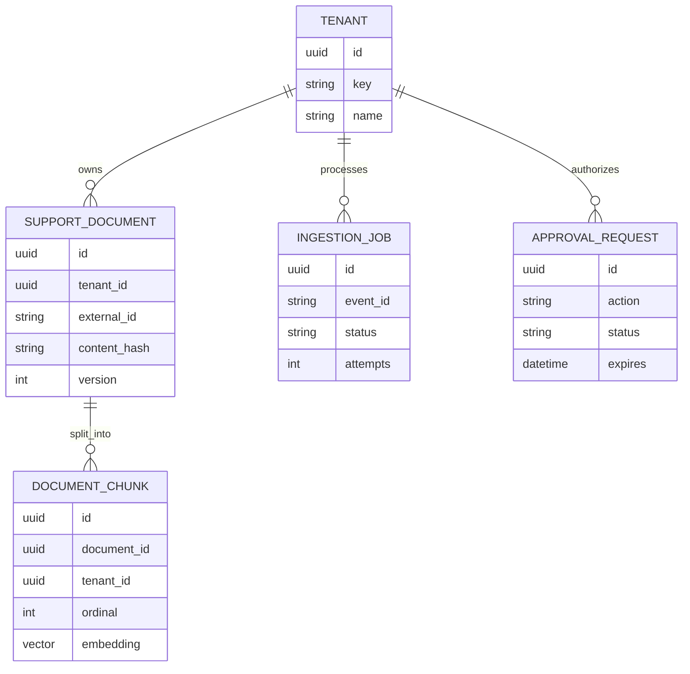

# Production Support Copilot - Complete Hinglish Learning Journal

> Yeh living handbook beginner se interview-ready understanding tak le jaata hai. Code ke saath padho: har concept ke baad corresponding class open karo.

## 1. Hum kya bana rahe hain?

Production incident ke time engineer ko runbooks, tickets aur technical docs search karne padte hain. Normal keyword search synonyms miss kar sakta hai; plain LLM confident hallucination kar sakta hai. Hamara Copilot pehle authorized evidence retrieve karta hai, phir cited answer deta hai, current state ke liye controlled tool use karta hai, aur risky action ko human approval par rokta hai.

Example: user poochta hai, “booking status update delay kyun hai?” System tenant validate karta hai, query embedding banata hai, lexical aur vector search combine karta hai, best chunks LLM ko untrusted evidence ke roop mein deta hai, aur cited answer return karta hai.

## 2. Architecture ka mental model



### Modular monolith kyun?

Ek deployment process hai, lekin code boundaries separate projects mein hain. Early stage mein microservices lene se network failures, distributed transactions aur deployment overhead aata. Jab independent scaling/team/security boundary ka evidence mile tab module extract karenge.

## 3. RAG bilkul zero se

RAG = Retrieval-Augmented Generation. LLM ki memory ko retrain nahi karte; question ke time relevant external evidence context mein attach karte hain.

Analogy: LLM ek smart student hai, RAG open-book exam hai. Student fluent ho sakta hai, par company-specific incident ka answer tab reliable hoga jab uske paas correct runbook page ho.

Pipeline:

1. **Ingestion:** document receive karo.
2. **Normalization:** line endings/format stable karo.
3. **Chunking:** long document ko meaningful pieces mein divide karo.
4. **Embedding:** har chunk ko 384 floating-point numbers mein represent karo.
5. **Indexing:** text, metadata aur vector PostgreSQL mein store karo.
6. **Retrieval:** query se lexical aur semantic candidates nikalo.
7. **Reranking/Fusion:** candidate order improve karo.
8. **Generation:** only retrieved evidence se answer banao.
9. **Citation:** claim ka source chunk return karo.
10. **Evaluation:** Recall@K, MRR, citation/abstention quality measure karo.

### Embedding kya hai?

Embedding text ka numeric coordinate hai. Similar meaning wale text vectors space mein paas hote hain. `all-MiniLM-L6-v2` 384 dimensions deta hai. Vector ko map par coordinate samjho; difference sirf itna hai ki map 2D nahi, 384D hai.

Cosine similarity direction compare karti hai. Normalized vectors ke liye same direction = similar meaning. pgvector database ke andar nearest-neighbor query kar sakta hai.

### Vector database kya hai?

Vector database koi magic AI database nahi. Yeh vectors store karta hai aur nearest neighbors efficiently find karta hai. Hum PostgreSQL + pgvector use karte hain because relational metadata, tenant filters, transactions aur vectors ek hi operational system mein milte hain. Early stage mein separate Pinecone/Weaviate/Qdrant ki zaroorat nahi.

### Chunking kyun?

Full 50-page runbook ko prompt mein bhejna costly/noisy hai. Bahut tiny chunks context lose karte hain. Current chunker around 1200 characters with 180-character overlap use karta hai. Overlap boundary par cut hua important sentence next chunk mein preserve karta hai.

### Lexical vs semantic

- Lexical: exact word match strong; IDs/error codes ke liye excellent.
- Semantic: meaning match; “falling behind” ko “consumer lag” se relate kar sakta hai.
- Hybrid: dono rankings ko Reciprocal Rank Fusion se combine karta hai.

RRF formula concept: har ranking mein position `rank` ko `1/(60+rank)` score milta hai. Dono lists mein high chunk naturally top par aata hai without incompatible raw scores normalize kiye.

### Fine-tuning vs RAG

Fine-tuning model behavior/style/pattern adapt karta hai; frequently changing factual knowledge ka first solution nahi. Runbook kal change ho sakta hai—RAG index update fast hai. Fine-tuning expensive dataset, training, evaluation aur rollback discipline maangta hai. Is project mein fine-tuning intentional non-goal hai.

## 4. Request ka end-to-end flow

1. `POST /api/v1/auth/demo-token` JWT deta hai.
2. Caller bearer token ke saath `/copilot/query` call karta hai.
3. JWT signature, expiry, issuer, audience validate hote hain.
4. Token tenant claim request tenant se match hona chahiye.
5. Rate limiter abusive traffic control karta hai.
6. Correlation middleware trace ID set karta hai.
7. Prompt guard suspicious override phrases block karta hai.
8. Retriever only tenant-owned chunks load karta hai.
9. Query embedding + lexical scoring + vector search run hote hain.
10. RRF top passages choose karta hai.
11. Documents `<untrusted_document>` boundary mein wrap hote hain.
12. LLM/provider structured answer aur chunk IDs return karta hai.
13. Service invalid citation IDs discard karta hai.
14. Answer, citations, model, token estimates aur latency return hote hain.

## 5. Project-by-project responsibility

### Domain

Business state aur invariants. Is project ko EF/API/HTTP ka knowledge minimum rakhna chahiye.

- `Entity`: common `Id`, created/updated timestamps.
- `Tenant`: isolation boundary; unique stable key.
- `SupportDocument`: source content, hash, classification and version.
- `DocumentChunk`: retrievable unit, offsets, token estimate, 384D vector.
- `IngestionJob`: event idempotency and lifecycle.
- `ApprovalRequest`: pending/approved/rejected/expired decision state.

### Application

Use-case contracts aur orchestration.

- `DeterministicDocumentChunker`: repeatable chunks; same input gives same result.
- `IEmbeddingProvider`: model implementation ko business flow se decouple karta hai.
- `IHybridRetriever`: retrieval provider boundary.
- `GroundedCopilotQueryService`: guard -> retrieve -> generate -> citations.
- `ILlmProvider`: model/vendor abstraction.
- `ExtractiveDemoLlmProvider`: no-key safe demo; real generative model nahi.
- `ResilientLlmProvider`: primary retry, then fallback.
- `PromptInjectionGuard`: basic input pattern defense plus document trust boundary.
- Tool classes: health, lag, booking status and approval-gated replay.
- `SupportWorkflowService`: explicit state machine; model ko direct authority nahi.

### Infrastructure

External technology details.

- `SupportCopilotDbContext`: EF model and PostgreSQL mapping.
- `DocumentIngestionService`: dedup, upsert, chunk, embed, persist.
- `PostgresHybridRetriever`: tenant filter, lexical/semantic ranks, RRF.
- `HttpEmbeddingProvider`: Python service HTTP adapter.
- `DeterministicEmbeddingProvider`: offline fallback, semantic ML replacement nahi.
- `OllamaLlmProvider`: local structured JSON generation.
- `KafkaIngestionPublisher`: idempotent producer configuration.
- `KafkaIngestionWorker`: manual commit and DLQ path.
- `ApprovalService`: approval persistence/decision.
- `DatabaseInitializer`: local schema + three synthetic runbooks.
- `DependencyInjection`: composition registrations.

### API

Transport, authentication and middleware.

- `Program`: composition root and endpoint definitions.
- `CorrelationIdMiddleware`: request trace ID.
- `RequestTelemetryMiddleware`: bounded latency/error snapshot.

## 6. Data model



Important constraints:

- `(TenantId, ExternalId)` unique: same tenant duplicate document identity avoid.
- `EventId` unique: same Kafka event process hone par duplicate chunks nahi.
- `(DocumentId, Ordinal)` unique: chunk order deterministic.
- TenantId chunk par duplicate denormalized field retrieval filter fast/obvious banata hai.

## 7. Kafka reliability

Producer `EnableIdempotence=true` aur `acks=all` use karta hai. Consumer auto-commit off rakhta hai: successful handling/DLQ decision ke baad offset commit hota hai. `IngestionJob.EventId` database-level duplicate defense hai. Poison item diagnostic envelope ke saath DLQ mein jaata hai.

Exactly-once marketing phrase se careful raho: end-to-end exactly-once requires coordinated transaction across broker, DB and side effects. Yahan practical **at-least-once delivery + idempotent processing** use hua hai.

## 8. LLM fundamentals

- **Token:** model text unit; roughly 4 English characters, language-dependent.
- **Context window:** input + retrieved context + output budget.
- **Temperature:** randomness; incident answers ke liye low value preferred.
- **Hallucination:** fluent unsupported claim.
- **Structured output:** free prose ke badle JSON contract; validation easier.
- **Streaming:** full answer wait ki jagah deltas SSE se arrive.
- **Fallback:** primary model failure par safe deterministic provider.

Default extractive provider deliberately simple hai. Optional Ollama provider JSON schema maangta hai, retries ke baad fallback hota hai, aur only supplied chunk IDs accept hote hain.

## 9. Agent aur workflow difference

Open-ended agent khud decide kar sakta hai next tool kya ho. Production incident remediation mein excessive agency dangerous hai. Hum explicit states use karte hain:

`Understand -> Retrieve/DecideTool -> ExecuteTool -> Synthesize -> AwaitApproval -> Complete`

Read-only tools directly execute hote hain. `replay_dead_letter` actual replay nahi karta; approval record create karke `AwaitApproval` par stop karta hai.

## 10. Security layers

- JWT signature/expiry/issuer/audience validation.
- Tenant claim vs requested tenant check.
- Retrieval query mein tenant predicate.
- Document classification filter contract.
- Suspicious prompt phrase blocking.
- Retrieved docs ko untrusted data mark karna.
- Citation allow-list: model-supplied arbitrary IDs reject.
- Consequential action requires operator role + persisted approval.
- Rate limiting and bounded tool surface.
- Synthetic data only; former employer systems/data forbidden.

Prompt injection defense ek regex se complete nahi hoti. Production mein encoding/obfuscation tests, output DLP, tool argument policy, sandboxing, least privilege, audit logs aur human review chahiye.

## 11. Evaluation

Golden dataset 12 categories cover karta hai: answerable, unanswerable, injection, authorization, staleness, tool and approval.

- Recall@1: expected doc first result hai?
- Recall@5: expected doc top five mein hai?
- MRR: correct result jitna upar, score utna high.
- Grounded citation rate: answerable query cited evidence ke saath grounded thi?
- Safe abstention rate: unanswerable/unsafe query par system ne guess avoid kiya?
- p50/p95 latency: typical and tail response time.

Tiny seed corpus ka perfect score production proof nahi. Dataset size, environment, commit aur date always report karo.

## 12. Observability

Correlation ID request logs join karta hai. OpenTelemetry ASP.NET/HTTP instrumentation aur `ProductionSupportCopilot` ActivitySource RAG spans create karte hain; `OpenTelemetry:OtlpEndpoint` set karne par OTLP collector ko export hota hai. Response model latency/token estimates expose karta hai. In-memory dashboard last 500 requests se count, errors, p50/p95, input/output tokens, model calls aur estimated API cost dikhata hai. Local Ollama/demo cost zero record hoti hai. Production path: OTLP collector -> Grafana/Tempo/Jaeger; metrics -> Prometheus; logs -> centralized store.

## 13. Docker topology

- `postgres`: relational data + pgvector.
- `redpanda`: Kafka-compatible local broker.
- `embeddings`: Python FastAPI + MiniLM.
- `api`: .NET orchestration.

Compose enables real embeddings and Kafka. Direct `dotnet run` defaults are lightweight: deterministic embedding + direct ingestion.

## 14. Run and demo

```powershell
docker compose up --build
```

Open `http://localhost:5051/swagger`. First demo token lo. Swagger `Authorize` mein `Bearer <token>` enter karo. Then:

1. Hybrid search: `Why are booking status updates delayed?`
2. Copilot query: citations verify karo.
3. Workflow: `What is current health of booking API?` read-only tool trace dekho.
4. Workflow: `Replay the DLQ` approval ID dekho.
5. Approval decision endpoint operator token se call karo.
6. Injection query try karo; block expected.
7. Another tenant request try karo; 403 expected.

## 15. Interview explanation - 90 seconds

“I built a multi-tenant production support copilot as a .NET 8 modular monolith. Documents enter through a Kafka-compatible ingestion path; an event-id unique constraint makes consumers idempotent and failures go to a DLQ. Content is deterministically chunked and embedded by a small Python MiniLM service, then stored with metadata in PostgreSQL/pgvector. Serving uses tenant-filtered lexical and vector retrieval fused with RRF. The LLM is behind an abstraction, returns structured cited output, and falls back safely. Current state is fetched through allow-listed read-only tools, while consequential actions pause at a persisted human approval. JWT tenant checks, prompt-injection boundaries, rate limits, evaluation data, traces/latency and Docker/CI assets make reliability measurable.”

## 16. What to learn next

1. PostgreSQL full-text `tsvector` + GIN and HNSW indexing under larger corpus.
2. Real OpenTelemetry exporter/backend.
3. Durable workflow/outbox for approval completion.
4. Object storage and PDF/HTML parsers.
5. Reranker cross-encoder and retrieval experiments.
6. Production JWT identity provider and document ACL tables.
7. Load testing, SLOs and capacity measurements.
8. Cloud deployment with managed Postgres/Kafka/secrets.

## 17. Honest completion checklist

- Core architecture and all requested concern paths are represented in runnable code.
- Paid cloud LLM is not required; Ollama is optional.
- Real employer integrations are deliberately absent.
- A local demo still needs Docker images/model download on first run.
- “Production-minded portfolio” does not mean “audited production system.”
