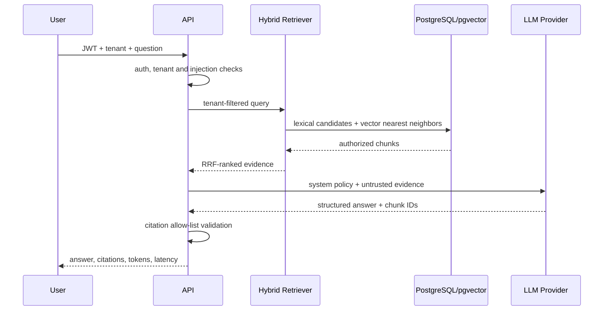

# Architecture and Capacity Design

## Goals

Produce evidence-grounded support answers, protect tenant data, inspect current synthetic state through controlled tools, and require approval before consequential operations.

## Main serving sequence

## Ingestion sequence

Event producers publish a keyed document command. The consumer uses manual offset commits. `IngestionJob.EventId` is unique, so redelivery returns a duplicate result rather than generating duplicate chunks. The service upserts document content, deterministically chunks it, embeds each chunk, and commits state. Failed commands are wrapped with diagnostics and sent to the DLQ.

## Capacity exercise

These are planning assumptions, not measured production numbers.

| Input | Assumption |
|---|---:|
| Tenants | 100 |
| Documents per tenant | 10,000 |
| Chunks per document | 20 |
| Total chunks | 20,000,000 |
| Embedding dimensions | 384 float32 |
| Raw vector size | about 1.5 KB |
| Raw vector storage | about 30 GB before row/index overhead |
| Peak query rate | 10 QPS |

At that size, use partition/ACL filters before ANN, HNSW based on measured recall/latency/memory, bounded connections, ingestion backpressure and batch embedding. The modular monolith can remain for serving while independently scaling an ingestion worker or model gateway if measurements justify extraction.

## SLO sketch

- 99.9% monthly API availability for grounded-query endpoint.
- p95 non-LLM retrieval under 300 ms at target corpus/load.
- no cross-tenant retrieved chunk in security regression suite.
- 100% consequential tool calls require valid operator approval.
- ingestion at-least-once, zero duplicate chunks for repeated event IDs.

## Key tradeoffs

- PostgreSQL + pgvector reduces operational systems and keeps metadata/ACL/vector transaction boundaries together.
- RRF combines incomparable lexical/vector raw scores without training; a cross-encoder can improve quality later at latency cost.
- Deterministic fallback prioritizes availability and grounding over fluent generation.
- Explicit workflow states are less flexible than an autonomous agent but substantially more auditable and safe.
- EF migrations are the controlled schema-evolution artifact; local development can auto-migrate and seed when `Database:Initialize=true`.

## Production hardening backlog

- Replace local JWT issuer with organizational OIDC and managed keys.
- Add document ACL groups beyond tenant-level filtering.
- Add transactional outbox for broker publication and durable workflow continuation.
- Export OpenTelemetry traces/metrics/logs to managed backends.
- Put secrets in Azure Key Vault with managed identity.
- Add PostgreSQL `tsvector`/GIN and measured HNSW settings.
- Add load, chaos, restore and multi-availability-zone tests.
- Use managed Postgres/Kafka and private networking; define backup/RPO/RTO.
