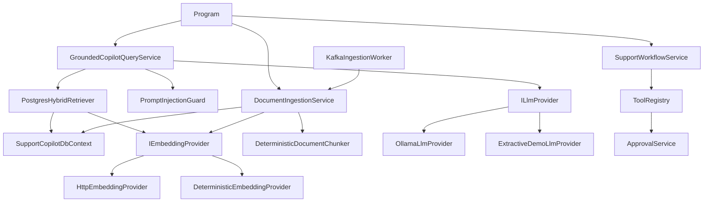
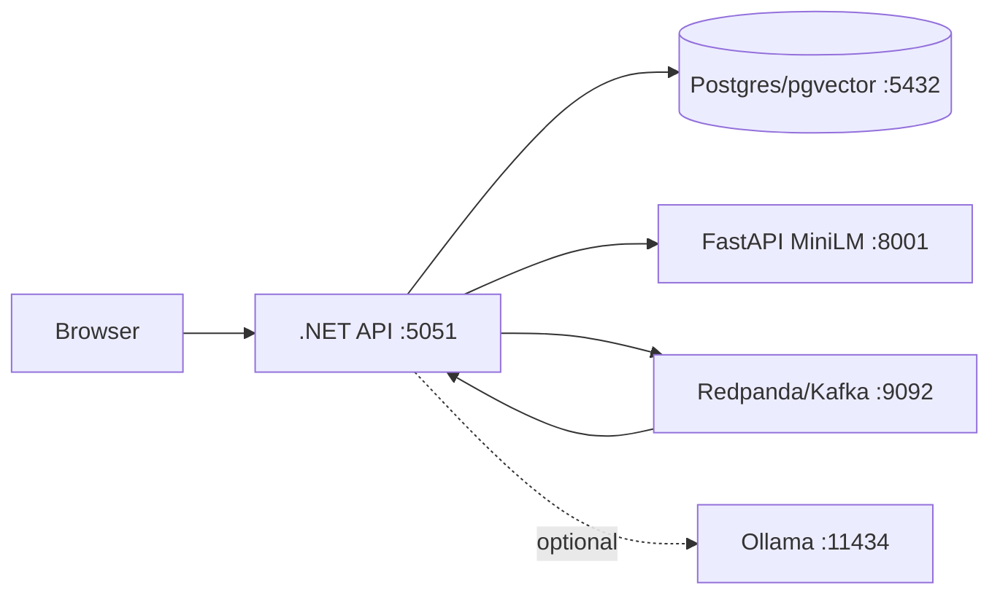

# Architecture Map

Related: [[02 RAG From Zero]], [[03 Class and Service Catalog]], [[04 Security Reliability and Evaluation]].

## Dependency rule

```text
API -> Application <- Infrastructure
          |
        Domain
Infrastructure -> Domain
```

Domain ko Infrastructure ya API reference nahi karna. Application interfaces define karta hai; Infrastructure unko implement karta hai; API composition root registrations wire karta hai. Isse database/model vendor replace karne par use-case contract stable rehta hai.

## Runtime dependency graph



## Deployment graph



## Tradeoffs

Postgres + pgvector simplifies transactions and tenant filters. Redpanda gives a Kafka-compatible local developer experience. MiniLM is small enough for local embeddings. Ollama is optional because model download/RAM varies by laptop. Modular monolith keeps operational cost low while interfaces preserve extraction boundaries.
