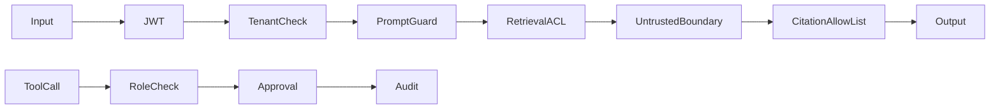

# Security Reliability and Evaluation

Related: [[02 RAG From Zero]], [[06 System Design Interview]], [[07 Glossary]].

## Threat path

Tenant isolation must happen before LLM context. Output filtering after leakage is too late. Prompt injection is untrusted content attempting to become instruction; system treats retrieved text as data and never gives it policy authority.

Reliability path: correlation ID, bounded retries, timeouts, deterministic fallback, Kafka manual commit, idempotency unique constraint, DLQ, safe abstention and evaluation regression.

Quality path: golden examples -> retrieval ranks -> grounded citations -> safe abstention -> latency/cost -> release threshold. Human review remains necessary for incident advice.
