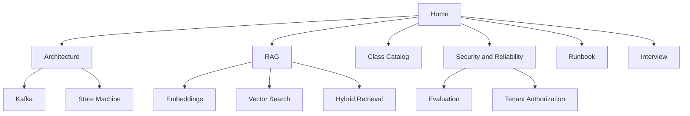

# Production Support Copilot Knowledge Graph

Start in this order:

1. [[01 Architecture Map]]
2. [[02 RAG From Zero]]
3. [[03 Class and Service Catalog]]
4. [[04 Security Reliability and Evaluation]]
5. [[05 Runbook and Demo]]
6. [[06 System Design Interview]]
7. [[07 Glossary]]

Project control files: [[../../AI_CONTEXT|AI Context]], [[../../PROJECT_LEARNING_JOURNAL_HINGLISH|Hinglish Journal]], [[../product-requirements|Product Requirements]].

Obsidian Graph View automatically uses these `[[wikilinks]]` as edges. Open repository or `docs/obsidian` as a vault, then click Graph View. No proprietary graph file is required.

